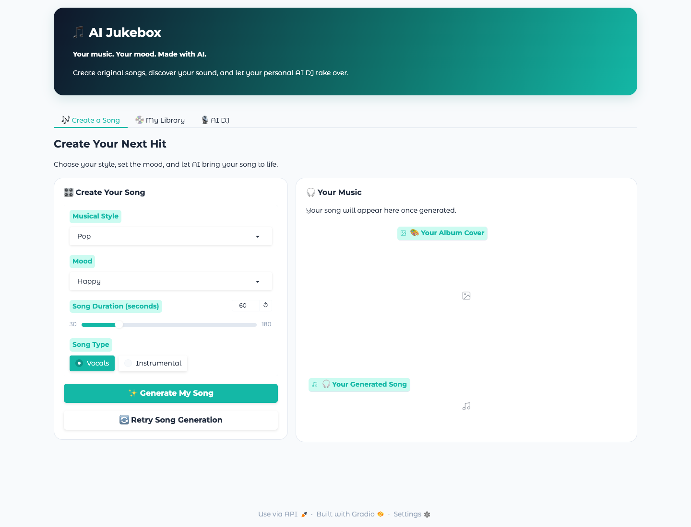
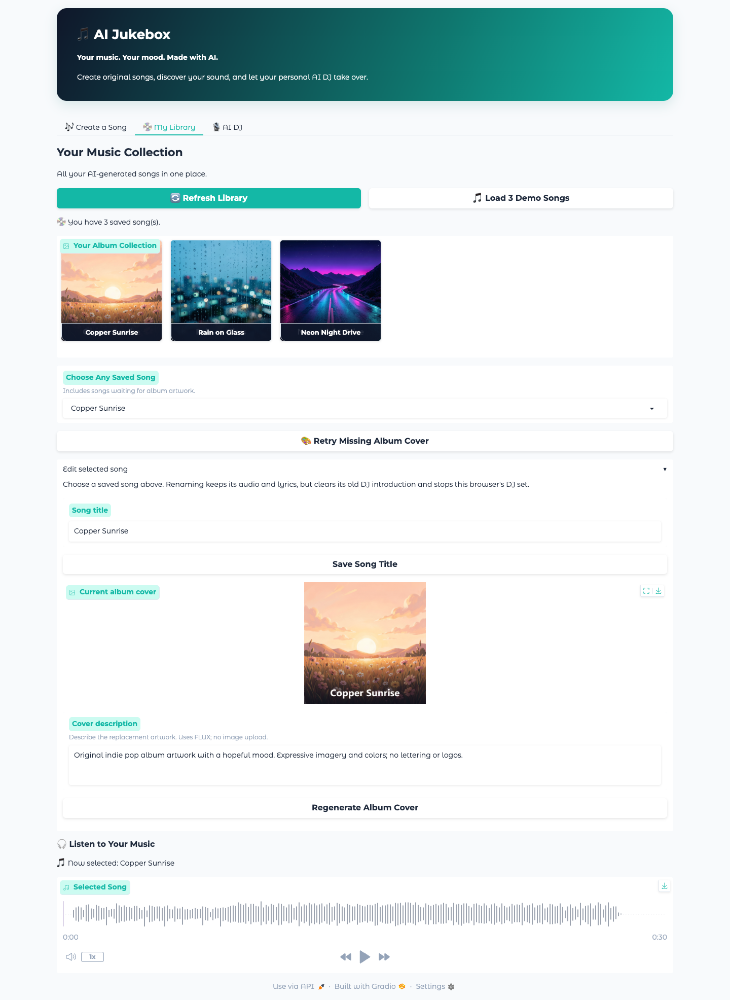
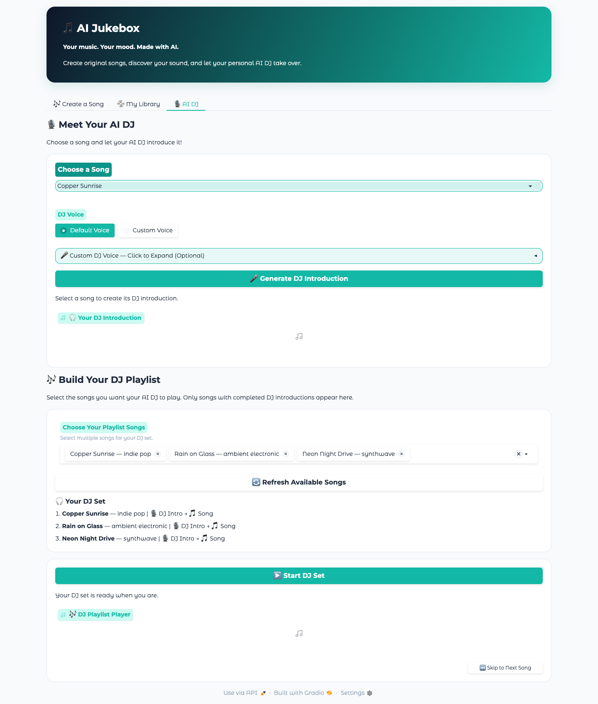
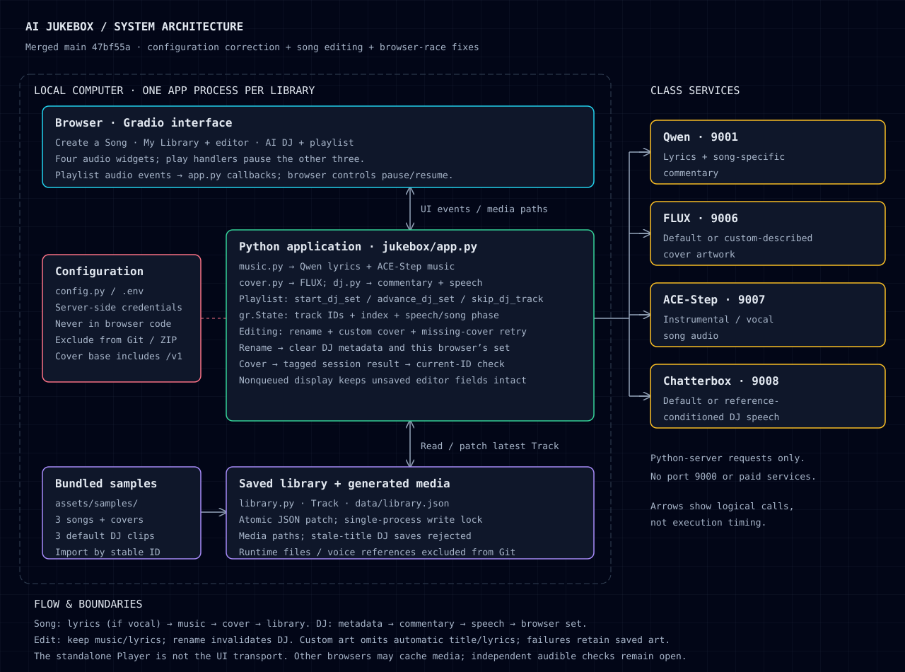

# AI Jukebox

MBAX 6418 Assignment 3. Create instrumental or vocal songs, generate matching covers, and play a collection with song-specific spoken DJ introductions using the class services.

This documentation draft describes merged source `47bf55a8ec10498b3a4534e86d9461a68ae271b1`, including the endpoint correction and song editor. The automated suite passes **204 tests with 17 warnings**. Fisher completed an independent GitHub-ZIP installation and technical feature checks, and approved the documentation at `4df1edc`. Human listening and a complete multi-song playback check remain open; see the submission checklist.

## Setup

### Requirements

- Python **3.11 or newer** and **uv**.
- **FFmpeg and ffprobe on PATH**, including for the sample integration tests. They are separate programs, not installed by `uv sync`.
- A browser, access to the class services, and the separately supplied endpoint handout and credentials.

Install these prerequisites for your operating system. From the extracted project root, containing `pyproject.toml`, `uv.lock`, `jukebox/`, and `assets/`, run:

```sh
uv --version
ffmpeg -version
ffprobe -version
uv sync --frozen --extra dev
uv run --frozen python --version
```

`pyproject.toml` requires `python-dotenv>=1.0`, `Pillow>=10.1`, and `gradio>=5.0,<6.0`; tests add `pytest>=8.0` and `pytest-timeout>=2.3`. The build backend requires `setuptools>=68`. `--frozen` uses the supplied `uv.lock` without updating it. The tested environment used Python 3.11.16 and Gradio 5.50.0 on macOS.

Keep the extracted directory together and run commands from its root, not inside `jukebox/`, because media paths are relative to the root. Git is not needed to run the ZIP. Fisher completed the ZIP setup on macOS with Python 3.12.13. FFmpeg and ffprobe were initially missing and had to be installed before the audio checks. Confirm both version commands above succeed before proceeding. Windows setup has not been verified.

### Endpoint configuration

Copy `.env.example` to `.env` in the project root. Replace `CLASS_HOST`, the key, and model placeholders below with the exact class-provided values. All nine settings are required when a service function loads configuration. Existing environment variables take precedence over `.env`.

```dotenv
API_KEY=replace-with-class-key
LLM_URL=http://CLASS_HOST:9001/v1
COVER_ART_URL=http://CLASS_HOST:9006/v1
MUSIC_URL=http://CLASS_HOST:9007
SPEECH_URL=http://CLASS_HOST:9008
LLM_MODEL=replace-with-served-qwen-model-id
COVER_ART_MODEL=replace-with-served-flux-model-id
MUSIC_MODEL=replace-with-served-ace-step-model-id
SPEECH_MODEL=replace-with-served-chatterbox-model-id
```

| Class service | Purpose | URL handling |
|---|---|---|
| Qwen3.6-35B-A3B, port 9001 | Lyrics and DJ commentary | Base includes `/v1`; client adds `/chat/completions` |
| FLUX.2 klein 4B, port 9006 | Cover art | Base includes `/v1`; client adds `/images/generations` |
| ACE-Step 1.5 XL Turbo, port 9007 | Music | Bare base; client adds `/release_task` and `/query_result` |
| Chatterbox Multilingual V3, port 9008 | DJ speech | Bare base; client adds `/v1/audio/speech` |

Keep credentials in the Python server's environment or local `.env`, never in browser fields, code, logs, screenshots, GitHub, or submission files. Do not package a credential-bearing handout. Use only class services for app features: no paid services or requests to port 9000. The placeholders are not working credentials or a check of current service availability.

### Launch

```sh
uv run --frozen python -m jukebox.app
```

Open the local address printed by Gradio and leave the terminal running. The app does not hardcode a port; use the printed address. Stop it with Ctrl+C.

New media and `data/library.json` are saved under ignored `data/`. Keep these runtime files to retain new tracks across launches, but exclude uploads and voice references from the submission. Run only one app process against a library directory; its write lock does not coordinate multiple processes.

## Using the app

### Generate a song and its cover

1. In **Create a Song**, choose **Musical Style**, **Mood**, **Song Duration (seconds)**, and **Song Type**. Duration ranges from **30–180 seconds in 15-second steps**; defaults are Pop / Happy / 60 seconds / Vocals.
2. Choose **Vocals** for Qwen-generated original lyrics or **Instrumental** for no vocal lyrics. Click **Generate My Song**.
3. Watch the progress indicator and final status. Play **Your Generated Song**, inspect **Your Album Cover**, and open **My Library** to find the saved track. Progress indicates an active request, not a measured percentage for each service.

If music generation fails, check the error and configuration, then click **Retry Song Generation**. This repeats the whole creation flow. If only the cover fails, the app saves the music with a warning. Select the song marked **cover pending** under **Choose Any Saved Song** and click **Retry Missing Album Cover** to retry artwork without generating new music. A separate saving error means the generated song may not have entered the library.

### Browse and edit the library

Click **Load 3 Demo Songs** to import the bundled songs, covers, and existing DJ clips without service calls. Select a cover or use **Choose Any Saved Song**, then use **Selected Song** to play/pause. The dropdown also includes songs without artwork. **Refresh Library**, or entering the tab, reloads saved records. Reimporting samples restores their bundled metadata under the same IDs rather than creating duplicate IDs.

Under **Edit selected song**:

- **Save Song Title** accepts a trimmed title of 1–200 characters. It preserves the track ID, music, lyrics, and cover. A changed title clears the old DJ commentary/audio reference and stops this browser's DJ preview and playlist; generate a new introduction and rebuild the set. An unchanged title does nothing.
- Enter a **Cover description** of 1–2000 characters and click **Regenerate Album Cover**. FLUX uses the description, style, and mood without automatically adding the title or lyrics. There is no image upload.
- Failed generation or saving keeps the previous saved artwork and leaves the unsaved description available for retry. Only successful descriptions persist. A slow request should not replace another selected song's editor or overwrite newer draft text.

Old media files are retained. Other open browsers may keep loaded audio until refreshed. These are local-library safeguards, not multi-process coordination.

### Generate DJ speech and play a set

1. In **AI DJ**, click **Refresh Available Songs**, then **Choose a Song**. The song dropdowns only update when you click this button — refresh after importing the demo songs or generating a new song, or the new tracks won't appear.
2. Use **Default Voice** without an upload, or choose **Custom Voice** and upload an MP3 or WAV you own or have permission to use. The optional URL field accepts a direct public HTTPS MP3/WAV; uploads take precedence. URL downloads reject redirects, nonpublic addresses, nonstandard HTTPS ports, and files above 10 MB.
3. Click **Generate DJ Introduction**. Qwen writes song-specific commentary and Chatterbox generates speech. Listen in the preview. For missing input or service errors, correct the problem and retry.
4. Click **Refresh Available Songs** again, then select **Choose Your Playlist Songs**. Refresh clears selections, so select afterward. Only songs with music and DJ audio paths appear; starting the set checks that their files exist.
5. Check **Your DJ Set** and press **Start DJ Set**. The queue is designed to play introduction → song → next introduction → next song automatically.
6. Use the playlist audio control to pause/resume. **Skip to Next Song** skips the entire current track, including remaining introduction or music; skipping the last track ends the set.

Starting any of the four audio players pauses the others without clearing their files. Recorded browser checks cover switching and skip cases; final-version audible progression and autoplay checks remain open. If autoplay is blocked, try the play control and record what happens.

## Interface screenshots

These October 27, 2026 captures show the documented app in isolated Chrome using bundled samples. The generation and library captures show the interface without starting playback. The DJ capture shows actual bundled speech playing after **Start DJ Set** was clicked; browser timing and audio-source checks are recorded in [playback verification](results/verification.md#bundled-dj-speech-playback-capture-issue-7-pr-17). No fresh AI generation or human listening test was performed.



Create a Song at its defaults, before generation.



My Library with all three samples and Copper Sunrise selected for playback and editing.



AI DJ with all three sample tracks queued and **Now introducing: Copper Sunrise** displayed. The playlist player shows about 0:02 of its 0:14 introduction and a pause control. The active HTML audio element's time advanced with `paused=false`; its source bytes matched the bundled Copper Sunrise DJ MP3. This is browser playback evidence, not human audible-listening confirmation.

## Architecture



Gradio events call `app.py`, which coordinates the music, cover, DJ, and library modules. Credentials stay on the Python server. Local JSON records hold track metadata and paths to generated or bundled media.

The UI queue uses Gradio session state and `start_dj_set`, `advance_dj_set`, and `skip_dj_track`; the audio stop event triggers advancement. Browser play handlers pause the other players. The separately tested `Player` class is **not** the UI playback transport. The optional `jukebox-architecture.html` preview shows the same diagram.

## Test results

The table separates historical live-service checks from automated tests with mocked services and recorded browser checks. The historical 10-second inputs are module tests, not options in the current 30-second-minimum UI.

| Feature / test | Inputs | Expected behavior | Actual result and scope |
|---|---|---|---|
| Instrumental music | Ambient electronic; calm; 10 seconds; instrumental | Playable instrumental audio of acceptable duration | Generated, decoded/duration-validated, and reported played locally. Historical live test, October 22 (`results/songs.md`). |
| Vocal music | Indie pop; hopeful; 10 seconds; automatic lyrics | Original Qwen lyrics and playable ACE-Step audio | Lyrics and audio generated; validation and local playback reported successful. Historical live test (`results/songs.md`). |
| Matching cover | Representative Track `issue3-manual-instrumental`, title Calm Ambient Electronic; ambient electronic/calm; 10 seconds; no audio | Square PNG on the same Track, other fields unchanged, calm/electronic fit | Decoded 1024×1024 RGB PNG; only `cover_path` changed. Qwen vision reported a suitable fit. Historical live test with representative metadata, not human visual review or song-to-UI integration (`results/covers.md`). |
| Default DJ | Real Calm Ambient Electronic instrumental Track; 10 seconds | Song-specific commentary and default speech | Two sentences, 212 characters, referenced title/style/mood; MP3 measured 9.88 seconds. Follow-up output passed full decode. Historical live test, October 24 (`results/dj.md`). |
| Custom DJ | Service-generated MP3 reference; “Thanks for listening. That was the custom voice check.” | Reference sent as `ref_audio`; valid speech | 2.88-second MP3 decoded; copied reference deleted. Follow-up output also decoded. Historical live test, not human voice likeness or browser upload verification (`results/dj.md`). |
| Song and cover saved together | Pop / Happy / 60 / Instrumental; mocked services | Both paths saved on one Track | Returned `song.mp3`, `cover.png`, and saved status; persisted metadata matched (`tests/test_app.py`). |
| Music failure | Pop / Happy / 60 / Vocals; mocked `SongGenerationError("Music service unavailable")` | No media; readable error | Both paths absent; status included the service error (`tests/test_app.py`). |
| Cover failure and recovery | Pop / Happy / 30 / Instrumental; mocked failure; separate `coverless-song` retry fixture | Keep successful music and retry only artwork | Initial failure saved music. Failed then successful retries retained `original-song.mp3`, added `recovered-cover.png`, and kept one record (`tests/test_app.py`). |
| Queue order | Two temporary Tracks with dummy audio; repeated advances | DJ1 → song1 → DJ2 → song2 → complete | Paths/phases matched; final audio cleared. Callback test, not audible/browser playback (`tests/test_app.py`). |
| Bundled samples | Three manifest records, six MP3s, three PNGs | Valid media, persistence, controller order and recovery | Integration tests passed with actual assets and a silent transport/simulated clock, not the UI (`tests/test_sample_integration.py`). |
| Browser switching and skip | All six player pairings, both directions; skip paused or near completion | Pause other player, retain audio; advance on skip | All reported PASS with no overlap. October 26 browser report does not name tester, browser, or exact SHA, or establish that skip preserves paused state (`results/verification.md`). |

### Independent teammate ZIP test

Fisher downloaded commit `9975855a8c41480edfbd7dc93d7dac5db09f25b2` from GitHub and installed it in a clean extracted folder on macOS, without reusing a clone or virtual environment. His report in [results/verification.md](results/verification.md#independent-github-zip-verification-issue-7-pr-17) records **204 tests passed, 17 warnings** and these results:

| Inputs / action | Expected | Reported result |
|---|---|---|
| Pop / Happy / 60 seconds, once Instrumental and once Vocals | New songs, covers and library entries; lyrics for vocal track | Both generated and decoded at 60 seconds; vocal lyrics present and instrumental lyrics absent |
| Rename to Verification Instrumental; regenerate sunset/ocean cover; refresh | Saved edits without replacement music | Title and cover persisted; UI reported audio unchanged |
| Default DJ, then custom voice using generated DJ MP3 as reference | Saved speech for the selected track | Both outputs decoded; durations 13.48 and 12.80 seconds; brief playback starts verified |
| One-item Copper Sunrise set; pause/resume, skip and restart | Controls work; introduction advances to music | Browser showed automatic speech-to-song transition, working controls and one unpaused audio element |

No application fixes were needed. The setup issue was missing FFmpeg/ffprobe, which were installed. These are technical checks: Fisher did not listen to the generated audio or assess voice likeness. The report does not establish WAV-reference testing, a full multi-song sequence, or independent coverage of every slow-request editing scenario. Those checks remain separate from the completed ZIP installation.

### Song editor checks

`results/song-editing.md` records:

- A real Gradio HTTP test using `gradio_client`, with mocked FLUX transport: rename, replace cover, inject failure, and reload all pass.
- Nine genuine headless Chrome scenarios passed twice, covering rename/DJ invalidation, slow selection changes, draft preservation, retry queuing, and reload persistence. Each run used seven synthetic requests and **zero live AI calls**. The earlier implementation failed the switch and rename cases; the fixes passed.
- Two successful live FLUX calls, one before and one after the lettering fix. With a warm amber sunrise/wildflower description, the first image included unwanted lettering; the post-fix image was a decoded 1024×1024 PNG with no visible lettering reported. Audio and lyrics were preserved. This used real callbacks, not a visual browser.
- Injected service/save failures and delayed updates preserve saved artwork and concurrent renames. DJ results for an obsolete title are rejected.

The Chrome-tested implementation differs from the documented merge only in `results/song-editing.md`. Silent synthetic browser audio does not establish audible playback. These checks do not replace independent teammate review.

### Automated suite

Run from the project root:

```sh
uv sync --frozen --extra dev
uv run --frozen pytest -q
```

On October 27, 2026, the exact documented source was checked in an isolated local export and tested with cached dependencies:

```sh
uv sync --offline --frozen --extra dev
GRADIO_ANALYTICS_ENABLED=False uv run --offline --frozen pytest -q
```

Latest local result:

```text
204 passed, 17 warnings
```

Warnings concern Gradio theme/CSS arguments and an upstream HTTP 422 constant. No tests were ignored and no live AI calls were made. This includes a real local HTTP app test with mocked service transport, but not a new Chrome run or listening check. A local export is not the required teammate installation from a GitHub-downloaded ZIP.

## Design judgment and lessons

### Keep successful music when artwork fails

Saving music even when the cover request fails gives the user a usable partial result. Earlier review found that a cover failure could discard valid audio from the library. The current flow saves the track, explains the missing cover, and offers an artwork-only retry. Tests confirm the original ID and audio survive failed and successful retries without generating music again. The saved-song dropdown matters here: a coverless track cannot appear in the cover gallery.

### Test playback at the browser boundary

Separate audio widgets created a possible overlap problem. Handlers now pause the other three players, and the recorded browser checks report successful switching and skip behavior. The lesson is that controller tests alone cannot prove browser behavior: the standalone `Player` is not the UI player. Its “skip while paused remains paused” test is stronger than the browser report's “advanced as expected.” Full audible queue progression, pause/resume, and autoplay still need final-version checks.

### Separate image generation from exact lettering

Initial sample covers had misspelled lettering. Regenerating text-free art and adding exact titles with Pillow fixed the bundled assets. Custom cover regeneration had a similar problem when the prompt automatically included title/lyrics; removing those additions produced one successful text-free live example. This is useful evidence, not a guarantee. New-song generation, cover retry, and cover regeneration now omit literal titles and lyric verses from the FLUX prompt and add the exact saved title as a local Pillow text overlay. The lower gradient and wrapped text keep titles readable. Pillow supplies a bundled scalable fallback font, so a system font installation is not required. User-supplied descriptions can still request unwanted lettering; text-free output from the image model is encouraged, not guaranteed. Regenerate a cover after renaming a song if you want its baked-in title updated. See `results/cover-title-overlay.md` for verification.

## How the samples were generated

| Sample | Style / mood | Mode | Song / DJ duration |
|---|---|---|---|
| Copper Sunrise | Indie pop / hopeful | Vocal, Qwen-generated lyrics | 30.00 s / 14.08 s |
| Rain on Glass | Ambient electronic / calm | Instrumental, no lyrics | 30.00 s / 17.72 s |
| Neon Night Drive | Synthwave / energetic | Instrumental, no lyrics | 30.00 s / 17.56 s |

The October 24 record in `results/samples.md` identifies generation source `26e6510375e3ab2b7571c23310425673cf18dab9`. Each sample used `generate_song(style, mood, 30, is_vocal)` with `lyrics=None`, followed by `generate_cover(track)`, `commentary_for_track(track)`, and default-voice `speak(text)`. Qwen supplied original lyrics for Copper Sunrise and commentary for all three; ACE-Step generated MP3 music, FLUX generated 1024×1024 PNGs, and Chatterbox generated MP3 introductions. No reference voice was uploaded.

Recorded model IDs were `cyankiwi/Qwen3.6-35B-A3B-AWQ-4bit`, `acestep/acestep-v15-xl-turbo`, `black-forest-labs/FLUX.2-klein-4B`, and `chatterbox-v3`. These identify the historical run; obtain current configuration values from the class handout.

After feedback about lettering, all three covers were regenerated with text-free prompts. Pillow added the exact titles using Segoe UI Bold and a dark lower gradient; the six audio files were unchanged. That font was needed for preparing the images, not playing them. The report retains prompts, lyrics, commentary, and reported favorable sample feedback; `assets/samples/samples.json` holds metadata and relative media paths. Feedback is not a completed final-version listening or ZIP test.

Package the generated samples, not third-party music, lyrics, art, or voice samples. Never include user uploads or voice-reference recordings.

## Before submission

- [ ] Complete deferred independent teammate review of song editing, including selection changes during slow regeneration/retry, draft preservation, rename/DJ invalidation, and reload persistence.
- [ ] Have the team verify this documentation against the finished app and explain the findings in its own words. Confirm the original starter prompt was retained and any additions were made before building; this draft does not establish that process history.
- [x] Fisher installed and technically tested the GitHub ZIP for `9975855a8c41480edfbd7dc93d7dac5db09f25b2` in a clean folder; environment, setup friction and results are recorded in `results/verification.md`. Download the final submission commit's matching ZIP and recheck any affected setup/features if it changes.
- [x] Record technical ZIP checks for new instrumental/vocal songs, covers, library edits, default DJ, MP3-reference DJ, and one-item playlist controls/transition.
- [ ] Complete human listening and a full multi-song sequence, including audible pause/resume, skip and non-overlap. WAV-reference behavior was not established by Fisher's MP3 test. Existing simulated failure/recovery tests cover a failure case; a deliberate live outage is not required.
- [x] Capture the queue playing bundled DJ speech for issue #7; browser state and source identity are recorded in `results/verification.md`. Human audible checks remain pending; Fisher's separate ZIP test is recorded below the capture evidence.
- [ ] Review and package the screenshots and SVG at their relative paths alongside the final `README.md`.
- [ ] Check the final package includes code, `pyproject.toml`, `uv.lock`, `.env.example`, documentation, sample manifest, three song MP3s, three DJ MP3s, and three covers. Exclude credentials, uploads, and voice references; previous audits do not establish that the final package is clean.
- [ ] Confirm every teammate's meaningful contribution and review of a teammate's work through issues/PRs, and instructor access through grading. Fisher approved documentation commit `4df1edc`; request confirmation of subsequent documentation changes before merge.
- [ ] After documentation review and final verification, submit one shared repository link, exact commit ID, and the **GitHub-downloaded ZIP for that same version** on Canvas. Nothing has been submitted by this documentation edit.

Issue #7 says “fresh clone,” but the assignment specifically requires an extracted GitHub ZIP. A clone or local archive does not substitute. If fixes change the submission commit, download the matching ZIP and recheck affected setup/features.
